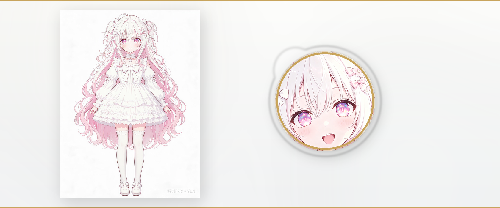

<div align="center">



<br />

# ✦ 柠木工作室 · Nimu Studio

### 美感即匠心 · Beauty is the craft

</div>

> 由 [Nimu Studio](https://nimustudio.cn) 维护 · 官网 [nimustudio.cn](https://nimustudio.cn)

---

开源 · 独立开发

柠木工作室主要从事 Web 前端与后端开发，并在 UI 设计、即时通讯与 AI 应用方向持续投入。

## 🧰 开源项目

| 项目 | 说明 |
|---|---|
| [**NimuQDock-dsh**](https://github.com/NimuStudio/NimuQDock-dsh) | QQ ↔ DeepSeek Harness 对接坞 · 带人格引擎的仿真群友：心情、精力、记忆，像真人一样潜水与参与 |
| [**Nimu Glass UI**](https://github.com/NimuStudio/Nimu-glass-ui) | 三主题玻璃拟态 UI 体系（Glass/Light/Dark）· 纯 CSS/JS 零依赖 |
| [**NimuChat**](https://github.com/NimuStudio/NimuChat) | 轻量 WebSocket 即时通讯组件 · 实时收发 + 断线重连 · 前后端完整可跑 |

## 🎮 游戏作品

| 项目 | 状态 | 说明 |
|---|---|---|
| **首部作品** | 开发中 | Galgame · 正式名称与发布日期将在确定后公布 |

## 🛠 技术栈

```
HTML / CSS / JS · Node.js / Express · WebSocket · SQLite
WebGL2（玻璃特效）· 响应式 Web / H5 双端
DeepSeek Harness · MCP · 人格引擎（YAML 角色卡）· OneBot v11 / NapCat
```

## 📬 联系

- GitHub：[@NimuStudio](https://github.com/NimuStudio)
- 官网：[nimustudio.cn](https://nimustudio.cn) · [English](https://nimustudio.cn/en/)
- QQ 交流群：**`1097466590`**
- 作者 QQ：**`2998827169`**
- 爱发电：[☕ 请我喝杯咖啡](https://ifdian.net/a/NimuStudio)
